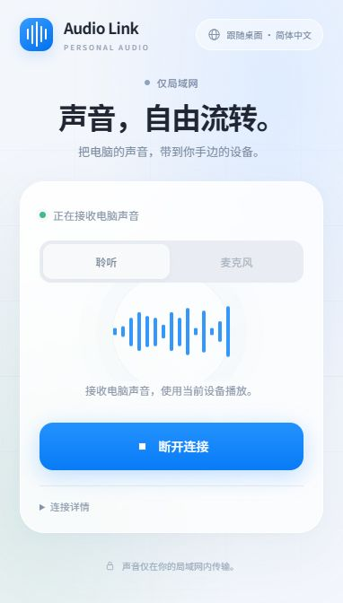

# Audio Link V2

**v2.0.0 · 2026-10-18** · [V2 release notes / 发布说明](docs/RELEASE-v2.md)

Stream Windows system audio to a browser on your phone, tablet or another computer.
An Apple-inspired desktop controller and responsive receiver UI, with no mobile app,
account or cloud server required. MIT licensed.

[中英文 / Bilingual](README.md) · [Usage guide](docs/USAGE.en.md) · [Architecture](docs/ARCHITECTURE.md) · [Security](SECURITY.md)



## Highlights

- WASAPI loopback capture, lossless PCM preferred, with WebRTC/Opus compatibility.
- Floating window, taskbar minimization, tray controls, scaling and corner docking.
- Pencil-button inline editing and per-browser device alias persistence.
- Nine desktop/browser languages with live synchronization.
- Optional reverse microphone stream and browser-side connection diagnostics.

## Recommended: deploy with Codex

We recommend **Codex-assisted local deployment and troubleshooting**. Open this
repository in Codex on, or with local access to, the Windows sender and provide
the following prompt. A cloud-only workspace cannot verify your PC's WASAPI
devices or local network. Codex is optional, not a runtime dependency or endorsement.

```text
Read this Audio Link repository's README, usage guide and security notes first.
Deploy it locally on this Windows PC. Check Python 3.12, playback devices and port conflicts.
Install requirements.txt in the project .venv, run the default tests and create a desktop shortcut.
Open the controller, verify the audio service, and report the receiver URL for other devices.
Preserve existing device aliases and unrelated files. Do not disable the firewall or expose public ports.
Explain and ask me to confirm or complete admin, firewall, certificate and microphone permission steps.
Finish with bilingual start/stop/reconnect instructions and clearly identify anything not verified.
```

Refer to [official OpenAI documentation](https://learn.chatgpt.com/docs/app) for
current app and permission guidance. Manual deployment remains fully supported.

## Manual quick start

### Lossless and compatibility

Both controller and receiver offer **Auto (lossless first), Lossless PCM, Compatible Opus**.
Auto is the default. Either end can change the shared setting; other clients synchronize
within roughly 2–3 seconds. Selection is persisted on the sender, separately from language.
The setting affects all updated Listen receivers, not microphone transport. Changing it
briefly reconnects active listeners; browser autoplay rules may require another tap.
Both UIs show actual modes with no maximum-quality banner. Expand Connection details for
per-device formats and receiver-reported buffer/loss/underrun metrics. Desktop data older
than ten seconds is shown as unknown, not live. Idle, negotiating and legacy unknown
connections are never labeled lossless. Auto tries PCM before Opus on each connection.
Auto falls back to lossy Opus on unsupported features, connection failure or buffer
overflow, showing the reason. Explicit PCM reports errors
instead of silently downgrading. PCM transports captured **16-bit mono/stereo** samples
at the capture device rate without a lossy codec: 48 kHz stereo is **1.536 Mb/s** before
network overhead. This is not an end-to-end source bit-perfect or 24-bit Hi-Res claim:
Windows mixing, surround downmix and receiver resampling remain outside the guarantee.
PCM requires HTTPS/AudioWorklet; ordinary LAN HTTP can use Opus. Diagnostics show the
actual format, playback buffer and cumulative underruns. Jitter, clock drift and screen
locking can still interrupt playback. Reverse microphone remains Opus. Developers can
run `node tests/test_worklet.js` for sample-processing tests.

The sender requires Windows 10/11, Python 3.12 with the Windows `py` launcher,
and an enabled playback device. Receivers need a modern WebRTC-capable browser.

1. Clone or extract the source.
2. Run `setup.cmd`, then `start.cmd`.
3. Start the service in the floating window.
4. On a device connected to the same router, open the displayed HTTPS address.
5. Only after verifying that the address is your own computer, handle its
   self-signed certificate prompt manually. Select Listen and start playback.

Do not run multiple installations on port 8787. Setup does not automatically
change firewall rules, expose public ports or configure startup tasks.
Create a desktop shortcut with `scripts/create_shortcut.ps1` after setup.

## Development

```powershell
.venv\Scripts\python.exe scripts/run_tests.py
.venv\Scripts\python.exe scripts/run_tests.py --audio-hardware
node --check web/receiver.js
.venv\Scripts\python.exe scripts/package_source.py
```

Default tests do not require an audio device. Hardware tests are opt-in.
The source archive `audio-link-v2.0.0-source.zip` and checksum
`SHA256SUMS-v2.0.0.txt` are generated under `dist/`.
Runtime data and secrets are excluded by an explicit release allowlist.

## Limitations

This is not zero-latency audio. Browser jitter-buffer readings are not total latency.
Background playback and screen wake locks depend on the OS/browser.
There is no authentication: use a trusted LAN only, never expose it to the internet.
Device IDs are random browser-local identifiers, not authentication credentials.
Clearing site storage or changing the browser/origin can reset identity.

Based on [Azec-Zuckerberg/pc-audio-to-iphone](https://github.com/Azec-Zuckerberg/pc-audio-to-iphone).
The upstream MIT notice is retained. This derivative adds the desktop controller,
device aliases, language synchronization and the new browser receiver.
Not affiliated with Apple or Microsoft.
